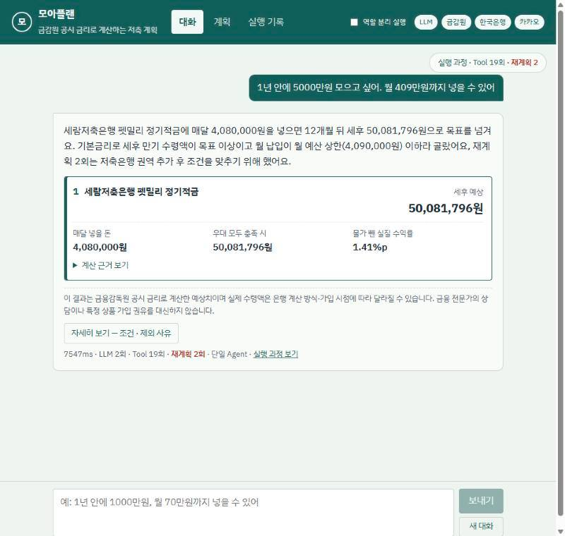
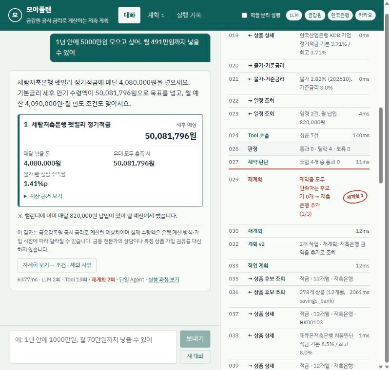
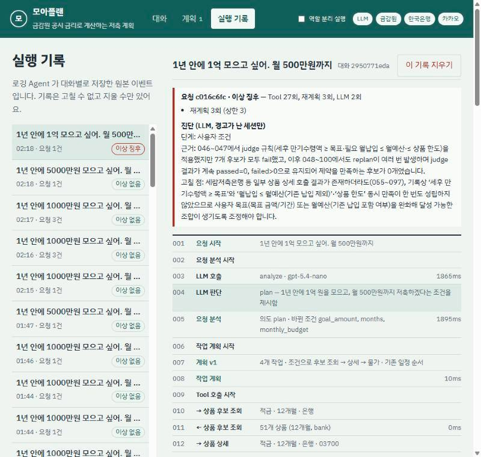

# 모아플랜 (MoaPlan)

목표 금액과 기간, 한 달에 넣을 수 있는 돈을 말하면 예적금 상품을 찾아서 저축 계획을 짜 주는 Agent입니다.
금감원에 공시된 금리로 세후 만기 수령액을 직접 계산하고, 조건에 맞는 상품이 없으면 저축은행까지 찾아보거나 월 납입액을 얼마로 늘려야 하는지 알려 줍니다.

- 기간: 2026.11 (개인 프로젝트, SSAFY AI 코어 프로젝트 3회차)
- 기술: Python, LangGraph, FastAPI, Vue 3, ChromaDB, SQLite



<br>

## 목적

LLM에게 "1년에 1000만 원 모으려면 어떤 적금이 좋아?"라고 물으면 그럴듯하게 답하지만 금리나 한도가 실제와 다릅니다. 그래서 상품 정보는 API에서 가져오고, 계산은 코드로 하고, LLM은 요청을 이해하고 요약하는 데만 쓰도록 나눴습니다.

우리WON뱅킹 아이디어 경진대회에서 팀으로 기획했던 서비스(이직할 때 금융 관련 일을 챙겨 주는 서비스) 중 저축 부분을 떼어서 실제로 만들어 본 것입니다.

<br>

## 데이터

| 출처 | 사용한 정보 |
|---|---|
| 금융감독원 금융상품 한눈에 | 예금·적금 기간별 금리, 월 한도, 가입 대상, 우대 조건 |
| 한국은행 ECOS | 소비자물가지수(물가상승률 계산), 기준금리 |
| 카카오 로컬 | 추천 은행 근처 영업점 |
| 금융위원회·금감원 안내 자료 | 예금자보호, 이자소득세, 중도해지 등 안내 문서 5개를 요약해서 RAG에 사용 (문서마다 출처와 확인 날짜 표시) |

API마다 하루 호출 제한이 있어서 금감원 상품 목록은 10분, ECOS는 1시간 동안 캐시합니다. 키 없이 실행할 수 있도록 연습용 응답 데이터를 `backend/tools/fixtures`에 넣어 두었습니다.

<br>

## 방법

```
요청 분석(LLM) → 작업 계획 → Tool 호출 → 조건 판단(코드) → 응답
                                    ↑            |
                                    └─ 재계획 ←──┘  통과한 상품이 없을 때만, 최대 3번
```

- 요청에서 목표 금액, 기간, 월 예산, 목돈, 지역 같은 조건을 뽑고, 목표 금액이나 기간이 없으면 Tool을 부르기 전에 되묻습니다.
- 후보 상품을 조회한 뒤 세후 수령액이 목표 이상인지, 필요한 월 납입액이 예산과 상품 한도 안인지 코드로 판단합니다.
- 통과한 상품이 없으면 저축은행 권역을 추가하는 식으로 재계획하고, 3번 해도 안 되면 목표나 예산을 얼마로 조정해야 하는지 역산해서 알려 줍니다.
- 저장한 계획의 납입일과 만기일을 캘린더에 등록하고, 이미 나가는 돈은 다음 계획을 세울 때 예산에서 뺍니다.
- 실행 기록을 저장하는 로깅 Agent를 따로 두고, 같은 호출 반복이나 재계획 상한 도달 같은 이상 징후를 규칙으로 잡습니다. 이상할 때만 LLM이 원인을 적습니다.
- Planner / Worker를 분리한 구조도 만들어서 단일 Agent와 비교했습니다.

자세한 설계는 [Agent 설계](docs/02_Agent설계.md), [Tool 정의서](docs/03_Tool정의서.md)에 있습니다.

<br>

## 결과

실제 API로 시나리오 9개를 세 가지 구조(단일 Agent, Planner/Worker, Worker LLM 끔)로 27번 실행했습니다. 27번 모두 기대한 결과와 같았습니다.

| 구조 | LLM 호출 | Tool 호출 | 재계획 | 응답 시간 |
|---|---|---|---|---|
| 단일 Agent | 1.89 | 7.22 | 0.56 | 4.4초 |
| Planner/Worker (Worker LLM 켬) | 2.00 | 7.22 | 0.56 | 4.4초 |
| Planner/Worker (Worker LLM 끔) | 1.89 | 7.22 | 0.56 | 4.0초 |

| 재계획 (은행권 탈락 → 저축은행 추가) | 이상 징후 진단 |
|---|---|
|  |  |

- Worker에 LLM을 붙이면 더 나아질 줄 알았는데 호출만 1번 늘고 결과는 같았습니다. 실패 원인이 거의 정해져 있어서 규칙으로 처리해도 충분했습니다.
- 공시에는 "가입 제한 없음"인데 실제로는 법인 전용인 적금이 개인에게 추천되고 있었습니다. 가입 대상 문구까지 확인하도록 고쳤습니다.
- 캘린더에 잡힌 납입 때문에 예산이 0원인데도 재계획을 3번 하면서 API를 27번 부르고 있었습니다. 예산이 없으면 바로 멈추게 바꿔서 7번으로 줄였습니다.
- 자동 테스트 56개 통과 (키 없이 실행 가능)

시나리오별 결과는 [평가 결과](docs/evaluation/results.md), 전체 검증은 [검증 결과](docs/05_검증결과.md)에 있습니다.

<br>

## 아쉬운 점

- 우대금리는 공시 문구에서 금리 숫자를 찾을 수 있을 때만 반영됩니다.
- 세금은 일반과세(15.4%)만 계산합니다.
- 영업점은 찾아 주지만 그 지점에서 해당 상품을 파는지는 알 수 없습니다.
- 계산은 예상치라 실제 은행 금액과 몇 원 정도 다를 수 있습니다.

<br>

## 실행

```bash
cd backend
python -m venv venv
source venv/Scripts/activate
pip install -r requirements.txt
cp -n .env.example .env        # 키 입력, 키가 없으면 MOAPLAN_FAKE=1
uvicorn app.main:app --reload --port 8000
```

http://localhost:8000 에서 화면, /docs에서 API 문서를 볼 수 있습니다.
테스트: backend에서 `python -m pytest`

예시 요청
- 1년 안에 1000만 원 모으고 싶어. 월 90만 원까지 넣을 수 있어. 강남 근처
- 월 85만 원으로 바꿔줘
- 1년이랑 2년 비교해줘. 2000만 원 모으고 싶어. 월 100만 원까지
- 예금자보호 한도가 얼마야?

<br>

## 폴더 구조

```
backend/
├─ agent/      실행 흐름(LangGraph), 계산, Tool 실행, LLM 연결
├─ tools/      금감원, ECOS, 카카오, RAG, 캘린더 Tool
├─ events/     로깅 Agent, 이상 징후 판정
├─ app/        FastAPI 서버, 계획 저장
├─ rag/docs/   안내 문서
└─ tests/      테스트
frontend/      Vue 3 화면
docs/          요구사항 정의서, 설계 문서, API 명세, 검증 결과
```

이 결과는 금감원 공시 금리로 계산한 예상치이며, 금융 상품 가입 권유를 대신하지 않습니다.
