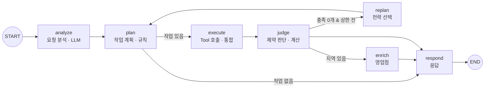
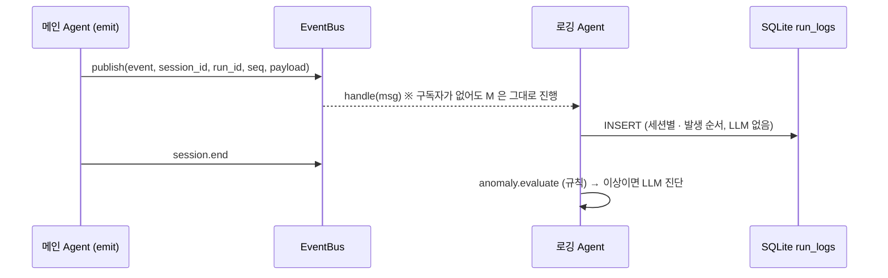

# 2. Agent 설계 문서

## 2.1 메인 Agent 실행 흐름 (LangGraph)

| 단계 | 입력 (State) | 하는 일 | 출력 | LLM |
|---|---|---|---|---|
| analyze | user, memory | 의도 분류와 이유, 조건 추출. 말하지 않은 값은 null. 이전 슬롯과 합쳐 바뀐 키만 갱신 | intent, slots, changed, missing | O (1회) |
| plan | intent, slots, tried | 의도별 Tool 순서를 정합니다. 필수 조건이 비면 작업 0개(되묻기), 인사도 작업 0개입니다 | tasks, plan_version | X |
| execute | tasks, results | 순서대로 호출하고, 검색 결과의 상품코드로 상세를 펼칩니다(expand). 실패는 기록하고 계속, 캐시를 재사용합니다 | results | X (Worker 모드는 조건부 O) |
| judge | results, slots | 조합별 세후 수령액, 필요 월 납입, 한도, 가입 제한, 기존 일정 반영 → 통과·탈락·보류 | verdict | X |
| replan | verdict, tried | 전략 선택: include_savings_bank → add_deposit → more_candidates(반복) | tried, replan_count | X |
| enrich | verdict | 1순위 추천 은행의 영업점 | branches | X |
| respond | verdict 등 | 숫자·표는 코드가 만들고, LLM은 2~3문장 요약만 씁니다. 면책 문구를 붙입니다 | answer, view | O (1회) |

**LLM 호출은 요청당 2회(분석·요약)로 고정합니다.** 의도·조건 추출처럼 언어를 이해해야 하는 일만 LLM에게 맡기고, 계산·판정·Tool 순서·재계획 전략은 규칙이 정합니다. 그래서 같은 입력이면 같은 결과가 나오고, 숫자를 지어낼 여지가 없습니다.

## 2.2 제약 판단 계산식 (agent/calc.py)

- 적금(정액적립식) 단리 이자 = `M × r/12 × n(n+1)/2`
- 적금 월복리 이자 = `M × Σ_{j=1..n}((1+r/12)^j − 1)`
- 예금 단리 = `P × r × n/12`, 월복리 = `P × ((1+r/12)^n − 1)`
- 세후 = 이자 × (1 − 15.4%). 비과세·세금우대는 개인 자격이라 적용하지 않습니다
- **판정:** `적금 세후 수령액 + 예금 세후 수령액(또는 목돈) ≥ 목표` 이면서 `필요 월 납입 ≤ 월 예산 − 이미 잡힌 납입` 이고 `≤ 상품 월 한도`
- **필요 월 납입 역산:** `(목표 − 예금 세후 수령액) ÷ (n + 월 1원당 세후 이자)`, 만 원 단위 올림
- **실질 수익률:** `세후 금리 − 물가상승률(ECOS 지수로 계산)`
- **기간 비교:** "1년이랑 2년 비교"처럼 요청하면 계획에 비교 기간의 은행 적금 조회 · 상세 작업을 더하고, 판정에서 기간마다 필요 월 납입이 가장 적은 상품을 골라 표로 보여 줍니다. 비교 중 재계획은 1번까지입니다.
- **확인할 수 없는 값:** 우대금리는 사용자가 말한 조건만, 공시 우대조건 문구에서 금리 숫자를 찾은 경우에만 더합니다(`agent/bonus.py`, 최고금리 상한). 말하지 않은 우대는 최고금리 수령액으로 참고만 보여 줍니다. 가입 제한 상품(서민전용·일부제한)은 '판정 보류'로 둡니다. 물가를 못 받으면 실질 수익률은 None입니다
- **순위:** 필요 월 납입이 적은 순, 같으면 세후 수령액이 큰 순
- **예금자보호:** 한 금융회사 예상 수령액이 1억 원을 넘으면 경고합니다

## 2.3 재계획 조건과 상한

| 조건 | 재계획 여부 |
|---|---|
| 통과 후보 0개, 남은 전략 있음, 횟수 < 3 | O |
| 통과 후보가 1개 이상 | X |
| `INVALID_KEY` (키 없음·틀림) | X — 다시 해도 같아서 바로 설정 안내 |
| 필수 조건 누락·모호함 | X — 되묻기 |
| 상한 3회 도달 | 멈추고 사유와 조정 방안(필요 월 납입, 도달 가능 목표, 필요 기간, 저축은행 허용)을 응답 |

전략은 이렇습니다. ① 저축은행 권역 추가(사용자가 금지하지 않았다면) ② 목돈이 있는데 예금을 안 봤다면 예금 조합 ③ 이미 받은 목록에서 다음 순위 4개의 상세(목록이 남아 있는 한 반복). 받은 결과는 `(Tool, 인자)` 캐시로 재사용하므로 같은 호출이 두 번 나가지 않습니다.

## 2.4 메인 Agent와 로깅 Agent의 관계

- **분리 기준:** 로깅 Agent를 구독하지 않아도 메인 Agent가 정상 응답합니다(`test_main_agent_runs_without_logging_agent`). 구독자에서 예외가 나도 버스가 삼킵니다.
- **LLM 판단 기록:** analyze 종료 시 `decision{kind:intent, value, reason}`, Worker 판단은 `worker.decision{action, reason, changed_args, fixed_args}`로 남깁니다.

## 2.5 대화 맥락 (Memory)

| 보관 | 보관하지 않음 |
|---|---|
| 조건 슬롯 8개 (우대 조건 포함) | Tool 원본 응답 |
| 직전 추천 요약(라벨, 금액, 상품 요약) | API 키, 오류 상세 |
| 마지막 저장 계획 번호 | — |
| 최근 6턴 요약 | — |

- **갱신:** LLM이 이번 메시지에서 말한 값만 채우고, `merge_slots`는 null이 아닌 바뀐 값만 덮어씁니다. 예를 들어 "월 85만 원으로 바꿔줘" → `changed = [monthly_budget]`.
- **Memory와 실행 캐시는 따로입니다.** 같은 대화의 후속 요청은 10분 동안 Tool 결과를 실행 캐시에서 재사용합니다. 이 캐시는 Memory에 저장하지 않습니다.

## 2.6 심화: Planner·Worker·로깅 Agent (F3021)

| Agent | 역할 | LLM을 부르는 조건 | 부르지 않는 조건 |
|---|---|---|---|
| Planner | 요청 분석, 작업 목록(고정 인자 표시), 재계획 | 자연어 요청 분석 (요청당 1회) | 작업 목록 구성, 재계획 전략 선택(규칙) |
| Worker | 작업 목록대로 Tool 수행 | 인자를 고치면 결과가 달라질 수 있는 실패(`NO_RESULT`·`NO_DATA`·`NOT_FOUND`·`BAD_ARGUMENT`)에서 재시도·건너뜀·계획 변경 판단 | 정상 경로, `INVALID_KEY`, `MISSING_ARGUMENT`, `AMBIGUOUS`, `NO_RATE` |
| 로깅 Agent | 수집·저장, 실행 중 검증 | 이상으로 판정된 실행의 원인 진단 | 수집·저장·판정(모두 규칙) |

- **고정 인자:** 예를 들어 영업점 검색의 `region`은 사용자가 말한 값이라 고정합니다. Worker LLM이 `region`을 바꾸라고 답해도 실행기가 걸러 냅니다.
- **실제 사례:** 공시 회사명이 "주식회사 OO은행"이면 영업점 검색이 `NO_RESULT`로 실패합니다. Worker LLM이 `bank_name`만 "OO은행"으로 고쳐 재시도해 지점을 찾습니다. 단일 Agent는 실패 사유만 보여 줍니다.
- **검증 → 재구성:** judge 뒤에 로깅 Agent가 지금까지의 이벤트를 규칙으로 검증합니다. 새 이상(반복 호출·계획 외 호출)이 나오면 Planner가 `rebuild_verified` 전략으로 계획된 작업만 다시 구성하고, 받은 결과는 캐시로 재사용합니다.
- **구조 비교:** `docs/evaluation/results.md` — 단일 Agent, 역할 분리(Worker LLM 켬), 역할 분리(Worker LLM 끔)의 요청당 LLM 호출 수, Tool 호출 수, 재계획 횟수, 응답 시간.
