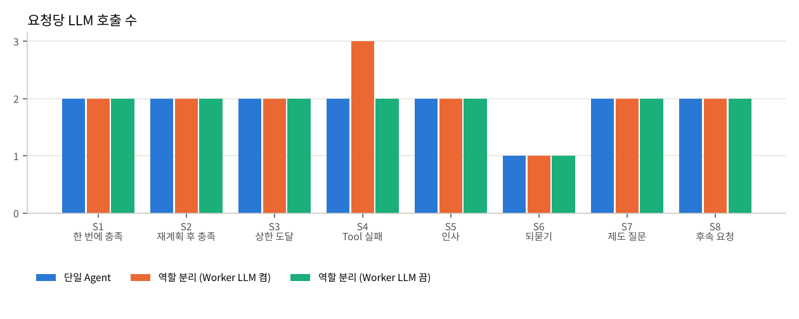
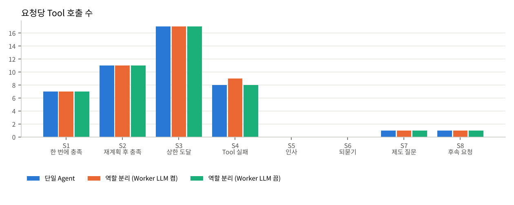
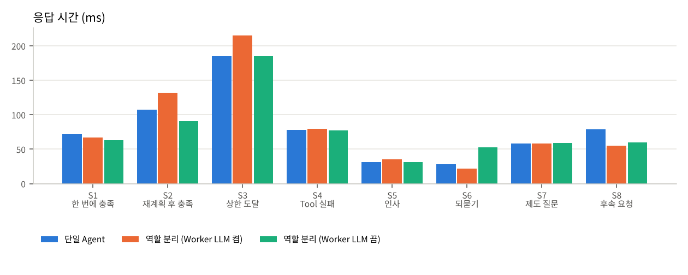

# 대표 시나리오 평가 결과 (연습 데이터 · 규칙 LLM)

`python -m scripts.evaluate --fake` 로 다시 만들 수 있다.

## 시나리오별 결과

| ID | 시나리오 | 구조 | 응답 | 추천 수 | 재계획 | Tool 호출 | 캐시 재사용 | LLM 호출 | 시간(ms) | 판정 | 기대와 차이 |
|---|---|---|---|---|---|---|---|---|---|---|---|
| S1 | 한 번에 충족 | single | plan | 2 | 0 | 7 | 0 | 2 | 72 | normal | 없음 |
| S1 | 한 번에 충족 | pw | plan | 2 | 0 | 7 | 0 | 2 | 67 | normal | 없음 |
| S1 | 한 번에 충족 | pw-off | plan | 2 | 0 | 7 | 0 | 2 | 63 | normal | 없음 |
| S2 | 재계획 후 충족 | single | plan | 1 | 1 | 11 | 0 | 2 | 107 | normal | 없음 |
| S2 | 재계획 후 충족 | pw | plan | 1 | 1 | 11 | 0 | 2 | 132 | normal | 없음 |
| S2 | 재계획 후 충족 | pw-off | plan | 1 | 1 | 11 | 0 | 2 | 91 | normal | 없음 |
| S3 | 재계획 상한 도달 | single | plan | 0 | 3 | 17 | 0 | 2 | 185 | anomaly | 없음 |
| S3 | 재계획 상한 도달 | pw | plan | 0 | 3 | 17 | 0 | 2 | 215 | anomaly | 없음 |
| S3 | 재계획 상한 도달 | pw-off | plan | 0 | 3 | 17 | 0 | 2 | 185 | anomaly | 없음 |
| S4 | Tool 하나 실패 (영업점 검색) | single | plan | 3 | 0 | 8 | 0 | 2 | 78 | normal | 없음 |
| S4 | Tool 하나 실패 (영업점 검색) | pw | plan | 3 | 0 | 9 | 0 | 3 | 80 | normal | 없음 |
| S4 | Tool 하나 실패 (영업점 검색) | pw-off | plan | 3 | 0 | 8 | 0 | 2 | 77 | normal | 없음 |
| S5 | Tool 불필요 (인사) | single | chitchat | 0 | 0 | 0 | 0 | 2 | 31 | normal | 없음 |
| S5 | Tool 불필요 (인사) | pw | chitchat | 0 | 0 | 0 | 0 | 2 | 35 | normal | 없음 |
| S5 | Tool 불필요 (인사) | pw-off | chitchat | 0 | 0 | 0 | 0 | 2 | 31 | normal | 없음 |
| S6 | 조건 부족 → 되묻기 | single | ask | 0 | 0 | 0 | 0 | 1 | 28 | normal | 없음 |
| S6 | 조건 부족 → 되묻기 | pw | ask | 0 | 0 | 0 | 0 | 1 | 22 | normal | 없음 |
| S6 | 조건 부족 → 되묻기 | pw-off | ask | 0 | 0 | 0 | 0 | 1 | 53 | normal | 없음 |
| S7 | 제도 질문 (RAG) | single | knowledge | 0 | 0 | 1 | 0 | 2 | 58 | normal | 없음 |
| S7 | 제도 질문 (RAG) | pw | knowledge | 0 | 0 | 1 | 0 | 2 | 58 | normal | 없음 |
| S7 | 제도 질문 (RAG) | pw-off | knowledge | 0 | 0 | 1 | 0 | 2 | 59 | normal | 없음 |
| S8 | 후속 요청 (조건 하나만 변경) | single | plan | 2 | 0 | 1 | 6 | 2 | 79 | normal | 없음 |
| S8 | 후속 요청 (조건 하나만 변경) | pw | plan | 2 | 0 | 1 | 6 | 2 | 55 | normal | 없음 |
| S8 | 후속 요청 (조건 하나만 변경) | pw-off | plan | 2 | 0 | 1 | 6 | 2 | 60 | normal | 없음 |

## 구조별 평균 (요청당)

| 구조 | LLM 호출 | Tool 호출 | 재계획 | 응답 시간(ms) | 기대와 다른 시나리오 |
|---|---|---|---|---|---|
| single | 1.88 | 5.62 | 0.50 | 80 | 0 |
| pw | 2.00 | 5.75 | 0.50 | 83 | 0 |
| pw-off | 1.88 | 5.62 | 0.50 | 77 | 0 |

## 이상 징후 판정 시험 (고장 주입, F3020)

| 주입 | 구조 | 판정 | 찾은 징후 | 재계획 | 캐시 재사용 | LLM 진단 |
|---|---|---|---|---|---|---|
| dup_call | single | anomaly | repeat_call | 0 | 0 | 같은 Tool 을 같은 입력으로 다시 불렀습니다. 실행 단계의 결과 캐시를 확인해야 합니다(메인 Agent/Worker). |
| rogue_call | single | anomaly | unplanned_call | 0 | 0 | 계획에 없던 Tool 호출이 있었습니다. Worker 가 작업 목록 밖에서 호출했는지 확인해야 합니다. |
| rogue_call | pw | anomaly | unplanned_call | 1 | 6 | 계획에 없던 Tool 호출이 있었습니다. Worker 가 작업 목록 밖에서 호출했는지 확인해야 합니다. |

## 시나리오별 최종 응답 (single)

**S1 한 번에 충족** — `1년 안에 1000만원 모으고 싶어. 월 90만원까지 넣을 수 있어`

> 조건을 모두 만족하는 조합 2개를 찾았습니다. 가장 유리한 안은 나래은행 나래 목돈만들기 적금으로 만기에 약 10,101,489원(세후)을 받을 것으로 계산됩니다.
> 
> 이 결과는 금융감독원 공시 금리로 계산한 예상치이며 실제 수령액은 은행 계산 방식·가입 시점에 따라 달라질 수 있습니다. 금융 전문가의 상담이나 특정 상품 가입 권유를 대신하지 않습니다.

**S2 재계획 후 충족** — `1년 안에 1000만원 모으고 싶어. 월 82만원까지 넣을 수 있어`

> 조건을 모두 만족하는 조합 1개를 찾았습니다. 가장 유리한 안은 사랑저축은행 사랑 정기적금으로 만기에 약 10,002,330원(세후)을 받을 것으로 계산됩니다.
> 
> 이 결과는 금융감독원 공시 금리로 계산한 예상치이며 실제 수령액은 은행 계산 방식·가입 시점에 따라 달라질 수 있습니다. 금융 전문가의 상담이나 특정 상품 가입 권유를 대신하지 않습니다.

**S3 재계획 상한 도달** — `1년 안에 5000만원 모으고 싶어. 월 100만원까지`

> 조건을 모두 만족하는 상품 조합을 찾지 못했습니다. 아래에 무엇을 조정하면 되는지 계산해 두었습니다.
> 
> 조정 방안: 월 납입을 4,100,000원으로 늘리기 (사랑저축은행 사랑 정기적금 기본금리 3.6% 기준) / 목표를 12,197,964원으로 낮추기 (지금 조건으로 모을 수 있는 최대)
> 이 결과는 금융감독원 공시 금리로 계산한 예상치이며 실제 수령액은 은행 계산 방식·가입 시점에 따라 달라질 수 있습니다. 금융 전문가의 상담이나 특정 상품 가입 권유를 대신하지 않습니다.

**S4 Tool 하나 실패 (영업점 검색)** — `2년 안에 1200만원 모으고 싶어. 월 50만원까지. 강남 근처`

> 조건을 모두 만족하는 조합 3개를 찾았습니다. 가장 유리한 안은 주식회사 바다은행 바다 급여 적금으로 만기에 약 12,096,814원(세후)을 받을 것으로 계산됩니다.
> 
> 이 결과는 금융감독원 공시 금리로 계산한 예상치이며 실제 수령액은 은행 계산 방식·가입 시점에 따라 달라질 수 있습니다. 금융 전문가의 상담이나 특정 상품 가입 권유를 대신하지 않습니다.

**S5 Tool 불필요 (인사)** — `안녕, 뭐 할 수 있어?`

> 안녕하세요! 모아플랜은 목표 금액과 기간을 말하면 금감원 공시 금리로 예·적금 조합을 계산해 드려요. 예: '1년 안에 1000만원 모으고 싶어, 월 70만원까지 넣을 수 있어'

**S6 조건 부족 → 되묻기** — `돈 좀 모으고 싶어. 월 50만원 가능해`

> 계획을 세우려면 모으려는 목표 금액과 모으는 기간(예: 1년, 6개월)이 필요합니다. 알려 주시겠어요?

**S7 제도 질문 (RAG)** — `예금자보호 한도가 얼마야?`

> 2025년 9월 1일부터 예금보호한도가 5천만 원에서 1억 원으로 올랐다. 한도는 금융회사별로 1인당 원금과 이자를 합쳐 1억 원이다. 서로 다른 금융회사에 맡긴 돈은 회사마다 따로 1억 원씩 보호된다.
> 
> - 출처: 금융위원회 카드뉴스 「9월 1일부터 1억 원까지 예금 보호」(복지로 게시, 2025-08-04) (https://www.bokjiro.go.kr/ssis-tbu/cms/pc/news/promotion/1308414_1118.html, 확인 2026-11-20)
> - 출처: 금융위원회 카드뉴스 「9월 1일부터 1억 원까지 예금 보호」(복지로 게시, 2025-08-04) (https://www.bokjiro.go.kr/ssis-tbu/cms/pc/news/promotion/1308414_1118.ht

**S8 후속 요청 (조건 하나만 변경)** — `월 85만원으로 바꿔줘`

> 조건을 모두 만족하는 조합 2개를 찾았습니다. 가장 유리한 안은 나래은행 나래 목돈만들기 적금으로 만기에 약 10,101,489원(세후)을 받을 것으로 계산됩니다.
> 
> 이 결과는 금융감독원 공시 금리로 계산한 예상치이며 실제 수령액은 은행 계산 방식·가입 시점에 따라 달라질 수 있습니다. 금융 전문가의 상담이나 특정 상품 가입 권유를 대신하지 않습니다.
