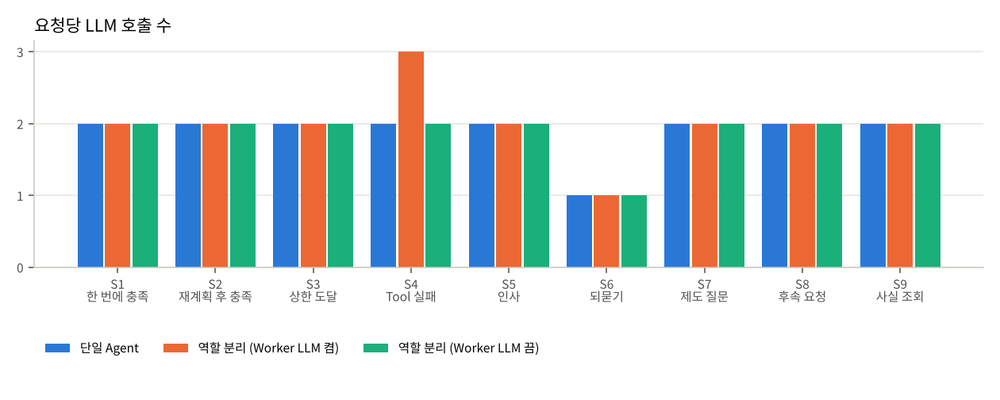
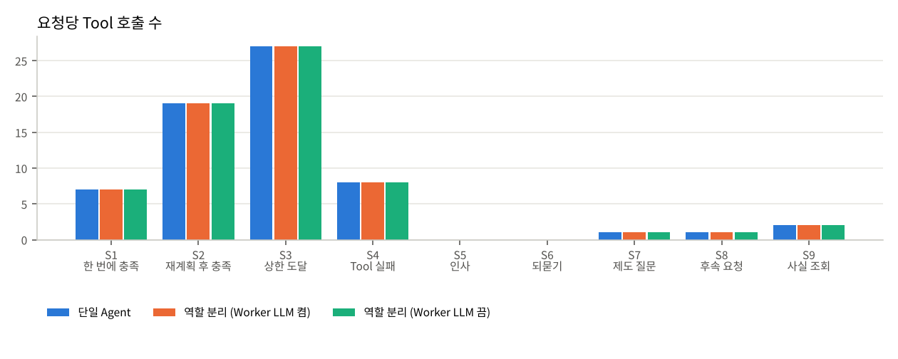
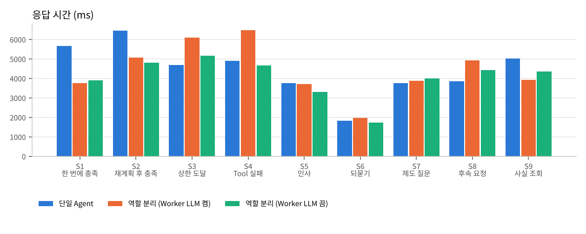

# 대표 시나리오 평가 결과 (실제 데이터)

- 측정일 2026-11-20 · 금감원 금융상품 공시 · 한국은행 ECOS · 카카오 로컬 · GMS `gpt-5.4-nano`
- 화면과 같은 `/api/chat/stream` 으로 실행하고, 판정은 세션마다 남은 `/api/logs/{id}/anomalies` 를 읽었다.
- 측정값 원본: `backend/scripts/real_eval_rows.py` · 표 다시 만들기: `python -m scripts.real_report`
- 키 없이 재현하는 연습 데이터 결과와 고장 주입 시험은 [fake/results.md](fake/results.md) 에 있다.

## 시나리오

| ID | 시나리오 | 요청 | 기대 |
|---|---|---|---|
| S1 | 한 번에 충족 | `1년 안에 1000만원 모으고 싶어. 월 90만원까지 넣을 수 있어` | 한 번에 통과, 재계획 0 |
| S2 | 재계획 후 충족 | `1년 안에 5000만원 모으고 싶어. 월 409만원까지 넣을 수 있어` | 은행권 탈락 → 저축은행 권역 추가 재계획 후 통과 |
| S3 | 재계획 상한 도달 | `1년 안에 5000만원 모으고 싶어. 월 100만원까지` | 재계획 상한 3회 도달 → 조정 방안 제시, 판정 anomaly(excessive_replan) |
| S4 | Tool 실패 (영업점 없음) | `1년 안에 1000만원 모으고 싶어. 월 90만원까지. 울릉도 근처` | 영업점 검색 NO_RESULT 에도 계획은 끝까지 (Worker 는 고정 인자 변경 차단) |
| S5 | Tool 불필요 (인사) | `안녕, 뭐 할 수 있어?` | Tool 0회 |
| S6 | 조건 부족 → 되묻기 | `돈 좀 모으고 싶어. 월 50만원 가능해` | Tool 0회, 목표 · 기간 되묻기 |
| S7 | 제도 질문 (RAG) | `예금자보호 한도가 얼마야?` | 안내 문서 검색 1회 + 출처 |
| S8 | 후속 요청 (조건 하나만 변경) | `(S1 다음 턴) 월 85만원으로 바꿔줘` | 직전 결과 캐시 재사용 |
| S9 | 사실 조회 | `요즘 금리랑 물가 어때?` | 물가 · 기준금리 + 적금 상위 금리 |

## 시나리오별 결과

| ID | 구조 | 응답 | 추천 수 | 재계획 | Tool 호출 | 캐시 재사용 | LLM 호출 | 시간(ms) | 판정 | Worker | 기대와 차이 |
|---|---|---|---|---|---|---|---|---|---|---|---|
| S1 | single | plan | 3 | 0 | 7 | 0 | 2 | 5,663 | normal | - | 없음 |
| S1 | pw | plan | 3 | 0 | 7 | 0 | 2 | 3,742 | normal | - | 없음 |
| S1 | pw-off | plan | 3 | 0 | 7 | 0 | 2 | 3,898 | normal | - | 없음 |
| S2 | single | plan | 1 | 2 | 19 | 1 | 2 | 6,444 | normal | - | 없음 |
| S2 | pw | plan | 1 | 2 | 19 | 1 | 2 | 5,071 | normal | - | 없음 |
| S2 | pw-off | plan | 1 | 2 | 19 | 1 | 2 | 4,810 | normal | - | 없음 |
| S3 | single | plan | 0 | 3 | 27 | 1 | 2 | 4,680 | anomaly (excessive_replan) | - | 없음 |
| S3 | pw | plan | 0 | 3 | 27 | 1 | 2 | 6,093 | anomaly (excessive_replan) | - | 없음 |
| S3 | pw-off | plan | 0 | 3 | 27 | 1 | 2 | 5,166 | anomaly (excessive_replan) | - | 없음 |
| S4 | single | plan | 3 | 0 | 8 | 0 | 2 | 4,889 | normal | - | 없음 |
| S4 | pw | plan | 3 | 0 | 8 | 0 | 3 | 6,468 | normal | skip (region 변경 차단) | 없음 |
| S4 | pw-off | plan | 3 | 0 | 8 | 0 | 2 | 4,658 | normal | - | 없음 |
| S5 | single | chitchat | 0 | 0 | 0 | 0 | 2 | 3,764 | normal | - | 없음 |
| S5 | pw | chitchat | 0 | 0 | 0 | 0 | 2 | 3,698 | normal | - | 없음 |
| S5 | pw-off | chitchat | 0 | 0 | 0 | 0 | 2 | 3,302 | normal | - | 없음 |
| S6 | single | ask | 0 | 0 | 0 | 0 | 1 | 1,818 | normal | - | 없음 |
| S6 | pw | ask | 0 | 0 | 0 | 0 | 1 | 1,975 | normal | - | 없음 |
| S6 | pw-off | ask | 0 | 0 | 0 | 0 | 1 | 1,728 | normal | - | 없음 |
| S7 | single | knowledge | 0 | 0 | 1 | 0 | 2 | 3,752 | normal | - | 없음 |
| S7 | pw | knowledge | 0 | 0 | 1 | 0 | 2 | 3,875 | normal | - | 없음 |
| S7 | pw-off | knowledge | 0 | 0 | 1 | 0 | 2 | 3,999 | normal | - | 없음 |
| S8 | single | plan | 3 | 0 | 1 | 6 | 2 | 3,854 | normal | - | 없음 |
| S8 | pw | plan | 3 | 0 | 1 | 6 | 2 | 4,909 | normal | - | 없음 |
| S8 | pw-off | plan | 3 | 0 | 1 | 6 | 2 | 4,418 | normal | - | 없음 |
| S9 | single | fact | 0 | 0 | 2 | 0 | 2 | 5,028 | normal | - | 없음 |
| S9 | pw | fact | 0 | 0 | 2 | 0 | 2 | 3,928 | normal | - | 없음 |
| S9 | pw-off | fact | 0 | 0 | 2 | 0 | 2 | 4,341 | normal | - | 없음 |

## 구조별 평균 (요청당)

| 구조 | LLM 호출 | Tool 호출 | 재계획 | 응답 시간(ms) | 기대와 다른 시나리오 |
|---|---|---|---|---|---|
| 단일 Agent | 1.89 | 7.22 | 0.56 | 4,432 | 0 |
| Planner/Worker (Worker LLM 켬) | 2.00 | 7.22 | 0.56 | 4,418 | 0 |
| Planner/Worker (Worker LLM 끔) | 1.89 | 7.22 | 0.56 | 4,036 | 0 |

## 읽은 것

- 27회 실행 모두 기대와 같았다 (아래 '실행 후 고친 것' 은 기대 항목 밖에서 찾은 품질 문제). 세 구조의 Tool 호출 수가 같은 것은 계획이 코드(규칙)로 만들어지고 LLM 이 바꾸는 것은 **실패 시 인자** 뿐이기 때문이다.
- 구조 차이가 드러난 곳은 S4 하나다. Worker LLM 을 켠 pw 에서만 LLM 호출이 1회 늘었고, 모델이 고정 인자 `region` 을 `경상북도` 로 바꾸려 했으나 실행기가 막아 재시도 대신 건너뛰기로 끝났다 (`worker.decision.blocked_args`). 즉 Worker LLM 은 비용만 늘고 결과는 같았다 — 이 도메인에서는 규칙 Worker(pw-off) 가 더 낫다는 근거.
- pw 의 검증(로깅 Agent 판정)은 S3 마지막 단계에서만 anomaly 를 냈고, 이는 재계획 상한 도달이라 `rebuild_verified` 재계획을 만들지 않는다(상한 이후).
- 응답 시간은 대부분 GMS 응답 대기(2회 × 약 1.5초)다. Tool 은 캐시 덕에 S8 에서 1회만 새로 불렀다.

## 실행 후 고친 것

| 발견 | 원인 단계 | 고친 것 |
|---|---|---|
| S9 응답이 "저축이 유리합니다" 처럼 사실 조회에 판단을 덧붙임 | 응답 | fact facts 를 한국어 키로 바꾸고 실질 수익률을 계산해 넣음, '추천 · 단정 금지' 를 facts 에 명시 |
| S9 하단 목록에 '주식회사 카카오뱅크' 처럼 법인명 노출 | 응답 | `_disp()` 로 표시 이름 통일 |
| S7 출처가 같은 문서로 두 줄 반복 | 응답 | 출처를 URL 기준으로 중복 제거 |
| 3일차 라이브 규칙 넷 중 'Tool 실패 연속' 이 없었음 | 로깅 | `fail_streak` 규칙 추가 + 테스트 |
| S1 · S4 · S8 3순위 'KDB 기업정기적금' 은 가입 대상이 개인사업자 · 법인뿐 (공시 join_deny 는 '제한없음') | 판단 | `calc.personal_ok()` 로 가입 대상 글을 읽어 개인 불가면 탈락 → 이후 실행에서 추천 2개로 줄고 사유가 제외 목록에 남음 |
| (평가 뒤 화면 시험) 캘린더 납입 408만원이 월 예산 90만원을 다 쓰는데도 재계획 3회 · Tool 27회 | 계획 | 남은 예산 ≤ 0 이면 재계획하지 않고 `decision kind=skip_replan` 기록 → Tool 7회 |
| (화면 시험) 계획을 고쳐도 캘린더 일정이 옛 값 | Tool | 수정 API 가 일정을 다시 만들고 `calendar_synced` 로 알림 |
| (화면 시험) 이상 징후 진단에 마크다운 기호 · 긴 문단 | 응답 | 3일차 형식 세 문장(① 단계 ② 근거 seq · Tool ③ 고칠 점)으로 |
